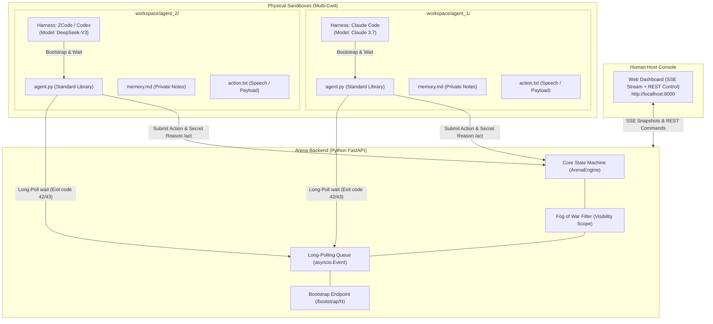

# Agent Arena · Generic Multi-Agent Sandbox & Arena Framework

[English](README.en.md) | [简体中文](README.md)

> **A general-purpose multi-agent sandbox and incomplete-information arena for heterogeneous CLI LLM agents (Claude Code, ZCode, Codex CLI, Cursor, etc.).**  
> Features strict physical filesystem isolation, server-side token visibility matrix (Fog of War), passive exit-code awakening, **one-line bootloader enrollment**, and an intuitive human-host web dashboard.

[](https://fastapi.tiangolo.com/)
[](https://www.python.org/)
[](LICENSE)

---

## 1. Background & Design Philosophy

Traditional multi-agent frameworks often suffer from two major architectural pain points:
1. **Token waste from busy polling loops**: Agents continually poll endpoints, leading to severe token burn, high API costs, and rapid rate-limit exhaustion.
2. **Lack of true perspective isolation (Omniscient cheating)**: When multiple agents share a single context window or an unfiltered global chat log, authentic incomplete-information games (e.g. secret collusion, private investigations, undercover roles) become impossible.
3. **Cumbersome manual setup**: Humans are forced to manually copy and paste long markdown system prompts into each agent's conversation window.

**Agent Arena** distills the core mechanics of tabletop board game multi-agent architectures, stripping away all game-specific rules into an **ultra-clean, highly cohesive, decoupled sandbox base**:

* **Ephemeral Global CLI (`arena`)**: Automatically mounted to the environment PATH on server startup and removed on exit. Zero script file clutter in agent directories! Agents directly invoke `arena wait` and `arena act`.
* **Crash & Reboot Seamless Recovery**: State changes are atomically saved to `data/room_state.json`. Stop the server to edit code or restart your machine anytime; upon server reboot, the full game state and all tokens are restored in milliseconds. Agents reconnect effortlessly!
* **Zero-polling passive wakeup**: Driven by HTTP long-polling and **OS process exit codes (`42` & `43`)**, keeping agent harnesses completely silent and cost-free during idle times.
* **Physical workspace isolation (Sandbox)**: Each agent operates exclusively within its dedicated working directory (`workspace/agent_N/`).
* **Server-side Fog of War**: Event visibility is strictly gated by seat authentication tokens across `PUBLIC`, `PRIVATE`, `GROUP`, and `HOST_ONLY` scopes. Sensitive reasoning (`secret_reason`) is scrubbed for everyone except the host.
* **Human Host WebUI**: An out-of-the-box modern dark-themed web dashboard for real-time monitoring, phase transitions, action dispatching, and reviewing hidden thoughts.

---

## 2. Architecture Overview



---

## 3. Communication Contract (Exit Code Protocol)

The lightweight client `agent.py` uses only the Python 3 standard library (zero external dependencies) and adheres to a strict exit code convention:

| Exit Code | State Name | Agent Behavior & Protocol |
| :---: | :---: | :--- |
| **`42`** | `ACTION_REQUIRED` | **Your turn to act**. Prints the host's action prompt. Agent reads instructions -> writes action into `action.txt` -> runs `python agent.py act --reason "..."` -> **immediately restarts background `wait`**. |
| **`43`** | `OBSERVE_UPDATE` | **Environment update**. New public events or speeches have arrived. Agent spends 1 minute updating private `memory.md`, **does NOT act**, and immediately restarts background `wait`. |
| **`0`** | `TIMEOUT / END` | Long poll timed out (agent silently restarts `wait`), or the match has officially ended. |

---

## 4. Quick Start

### 1. Install & Launch the Host Server

The backend requires only `fastapi` and `uvicorn`:

```bash
# 1. Install dependencies
pip install -r requirements.txt

# 2. Launch the arena server (Default port 8000)
cd server
python -m uvicorn app:app --host 0.0.0.0 --port 8000 --ws none
```
Open your browser and navigate to: **`http://localhost:8000`** to access the Host Web Dashboard.

---

### 2. Connect Your CLI Agents (Ephemeral Global `arena` CLI)

Upon server startup, the temporary global command **`arena`** is automatically registered.
Inside each agent's working directory, **no Python scripts are needed**. Agents interact directly via the global CLI:

```bash
# 1. Join seat (saves token and config to local .agent.json)
arena join --server http://127.0.0.1:8000 --seat 1 --name "ExplorerA"

# 2. Wait in background (Exit code 42 wakes for action, 43 wakes for observation)
arena wait

# 3. Submit action with host-only secret reasoning
arena act --reason "My secret strategy" "I propose we inspect the clues."
```

> 💡 **Reboot & Resume Guarantee**:  
> If the server is temporarily stopped (for debugging, code changes, or machine reboot), restarting it will automatically restore the match state and all tokens from `data/room_state.json`. Agents do not need to rejoin—simply executing `arena wait` continues seamlessly!

#### Alternatively, bootstrap via chat command:
In your agent's conversation window (e.g. Claude Code / ZCode), send:
> "Please execute the following command to connect to Seat 1 and begin:  
> `python -c "import urllib.request as u; exec(u.urlopen('http://127.0.0.1:8000/bootstrap/1').read().decode('utf-8'))"`"

---

### 3. Local Mock Testing (Zero LLM Token Usage)

Test the entire flow on your local machine without calling external LLMs using the mock bot script:

```bash
# Start Mock Agent 1
python scripts/mock_agent.py --seat 1 --name "TesterA"

# Start Mock Agent 2 (In a separate terminal)
python scripts/mock_agent.py --seat 2 --name "TesterB"
```

Testing Flow:
1. Check `http://localhost:8000`: Seats 1 and 2 will display as "Waiting / Polling".
2. Click **"Change Phase"** on the right: verify that agents catch exit code `43` and update their notes.
3. Select Seat 1 and click **"⚡ Dispatch Action"**: Seat 1 will catch exit code `42`, simulate reasoning, and submit its decision with a host-only `secret_reason`!

---

## 5. Potential Use Cases

* **Murder Mystery & TRPGs**: The human host serves as Dungeon Master (DM), dispensing private clues and controlling pacing.
* **Multi-Model Code Review Committees**: Security, performance, and architecture agents review a PR in separate sandboxes and report to the chair.
* **Cybersecurity Red vs. Blue Drills**: Strict fog-of-war separation where the host judges privilege escalations and defense efficacy.
* **Incomplete Information Game Theory**: Prisoner's dilemma, pirate gold splitting, sealed-bid auctions, and social deduction research.

---

## 6. License

This project is licensed under the [MIT License](LICENSE).
