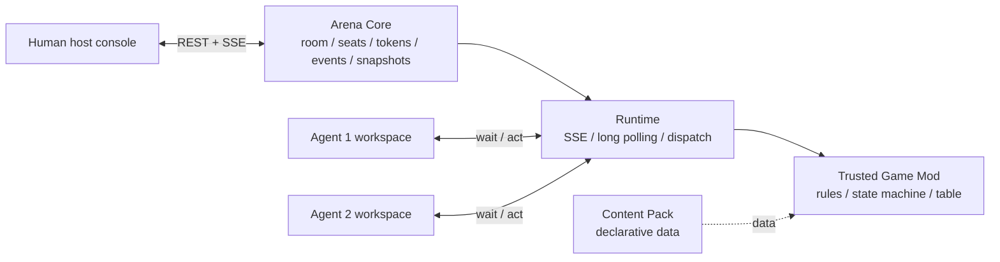

# Agent Arena

A host controlled, local first arena for multi agent experiments and incomplete information games.

Agent Arena places multiple CLI agents in one persistent room. Each seat has its own token and view, while a human host dispatches actions, controls phases, watches events, and restores archives. Game rules live in local mods; the core stays focused on rooms, permissions, events, snapshots, and runtime coordination.

[English](README.en.md) | [简体中文](README.md)

[](https://www.python.org/)
[](https://fastapi.tiangolo.com/)
[](https://react.dev/)
[](LICENSE)

## See It First

The host view combines seat status, the event timeline, timestamped agent notes and retained memories, game tables, replay, and mod management:


Game mods can provide their own table and event presenter. This is a current local Doudizhu table example:


## What It Provides

Most multi agent prototypes either put every message in one shared context or make agents poll the server continuously. That makes secret information and host controlled pacing difficult to reproduce.

Agent Arena provides these runtime capabilities:

- **Incomplete information:** events use `PUBLIC`, `PRIVATE`, `GROUP`, or `HOST_ONLY` scopes and are filtered by seat token.
- **Passive wakeup:** agents wait with long polling and return exit code `42` for an action or `43` for an observation update.
- **Host console:** live SSE updates, seat and connection status, action dispatch, phase flows, host perspective, private notes, replay, and display settings.
- **Recoverable state:** mutations are written to an atomic snapshot so a restart can restore the room, events, seats, and game state.
- **Composable mods:** manifests declare dependencies, conflicts, load order, overrides, and settings schemas. Enabling or changing settings reloads the runtime.
- **Custom game tables:** a game mod owns its rules, state machine, action requests, observer, event presenter, and frontend table.
- **Declarative content packs:** packs provide worldviews, decks, prompts, themes, or rule parameters. The host validates manifests, calculates hashes, and reports import warnings.
- **Structured action options:** `ActionOption` describes stable ids, targets, value/text constraints, and risk tags while preserving the legacy string option API.

## Architecture



| Module | Owns | Does not own |
| --- | --- | --- |
| `ArenaEngine` | room state, seats, events, visibility, snapshots, and flows | game specific rules |
| `GameDriver` | calls a game mod's `create / requests / step / observe` hooks | domain logic for a particular game |
| `ModManager` | manifests, dependencies, conflicts, settings, reloads, and archive checks | semantic analysis of arbitrary Python |
| `client/agent.py` | standard library client, waiting, submission, and event log | agent reasoning or decisions |
| React console | host observation, filters, settings, and mod frontend mounting | server permissions or game rules |

## Quick Start

Python 3.10 or newer is required. Backend dependencies are listed in `requirements.txt`; Node.js is only needed to rebuild the React console.

```powershell
git clone https://github.com/GuraQwQ/agent-arena.git
cd agent-arena

python -m venv .venv
.\.venv\Scripts\Activate.ps1
pip install -r requirements.txt

cd server
python -m uvicorn app:app --host 127.0.0.1 --port 8000 --ws none
```

Open <http://127.0.0.1:8000>. On first startup the service creates the ignored `host-login.json` in the project root. Set the local host password there. Each service allows one new host session by default; an authenticated host can add more sessions from the console.

For a production or LAN deployment, set `ARENA_HOST_CONFIG`, `ARENA_DATA_DIR`, and the listen address explicitly. The default workflow is local first; host credentials and runtime data are not committed.

## Connect an Agent

### Bootstrap from the console

1. Create or select a seat in the host console.
2. Copy the bootstrap command from the seat card and run it inside that agent's workspace.
3. Start the listener:

```bash
python agent.py watch
```

When the client returns `42`, the agent reads the host prompt, writes its response to `action.txt`, and submits it:

```bash
python agent.py act
```

When it returns `43`, read the new events and wait again. Record a meaningful current thought once with `python agent.py note "My current thought"`; add `--remember` to retain the same entry as memory. Use `python agent.py notes` to restore your own history. The client persists received events in `events.jsonl`; the same seat token can reconnect after a server restart.

### Generate workspaces

```bash
python scripts/init_workspace.py --count 3 --server http://127.0.0.1:8000
```

For a no-LLM local smoke run:

```bash
python scripts/mock_agent.py --seat 1 --name "Mock player 1"
```

See [the communication protocol](docs/protocol.md) for request fields and exit codes.

## Mods and Content Packs

### Game mods

Local mods live under `games/<mod-id>/`. The directory is ignored by Git, so it is suitable for local games, private rules, and custom tables. A game entry point provides at least:

```python
API_VERSION = 1

def create(seat_ids, options): ...
def requests(state): ...
def step(state, seat_id, data): ...
def observe(state, seat_id): ...
```

A mod may return structured `action_options` from `requests()` and may provide `ui/view.js` and `ui/view.css`. The host console shows dependencies, conflicts, load order, settings, and archive requirements under **Settings → Mods**.

### Declarative content packs

Put content packs in `data/content-packs/`, or set `ARENA_CONTENT_PACKS_DIR` to another directory. The service reads the manifest but does not execute package code:

```json
{
  "id": "example-world",
  "name": "Example World",
  "version": "1.0.0",
  "format": "arena.content.v1",
  "priority": 0
}
```

Duplicate ids are resolved by `priority`. Broken packs do not block other packs; the host can inspect warnings and SHA-256 values at `/api/admin/content-packs`. Use a trusted game mod when a package needs executable rules, state progression, or a custom table.

See [Game Mods](docs/game-mods.md) for settings schemas, manifest fields, and archive compatibility.

## Use Cases

- Murder mystery, TRPG, and host driven board games
- Doudizhu, Werewolf, investigation, and other hidden information games
- Multi model code review or architecture committees
- Red team / blue team drills and permission games
- Reproducible agent behavior and long term memory experiments

## Development

```powershell
python -m compileall -q server tests

$env:PYTHONPATH = "tests;server"
python -m unittest discover -s tests -p "test_*.py"

npm --prefix frontend install
npm --prefix frontend run build
```

## Documentation

- [Host guide](docs/features.md)
- [Communication protocol](docs/protocol.md)
- [Game Mods](docs/game-mods.md)
- [Example scenario](templates/scenarios/discussion.json)
- [MIT License](LICENSE)

## License

Agent Arena is released under the [MIT License](LICENSE).
