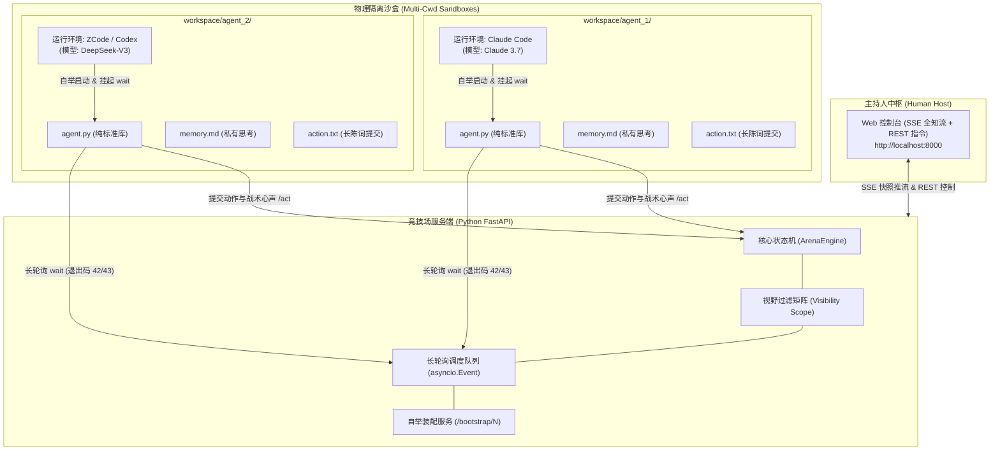

# Agent Arena · 通用多智能体独立操作与沙盒博弈基座

[English](README.en.md) | [简体中文](README.md)

> **面向异构大模型命令行智能体（Claude Code、ZCode、Codex CLI 等）的通用非完全信息博弈与多 Agent 协同底座。**  
> 具备物理目录隔离、服务端令牌视野矩阵（战争迷雾）、退出码被动唤醒机制、**一键口令自举接入**以及人类主持人全知调度 Web 控制台。

[](https://fastapi.tiangolo.com/)
[](https://www.python.org/)
[](LICENSE)

---

## 一、 项目背景与设计哲学

在传统的多智能体（Multi-Agent）框架中，往往存在两个难以落地的痛点：
1. **死循环轮询浪费 Token**：Agent 频繁调用 API 轮询最新状态，造成高昂的 API 费用与速率限制（Rate Limit）。
2. **缺乏真正的视野隔离（全知作弊）**：多个 Agent 共享单一上下文窗口或全局聊天记录，无法实现严格的非完全信息博弈（如暗中结盟、私密调查、卧底身份掩护）。
3. **初始化配置繁重原始**：需要人类手动向每个 Agent 对话框人肉复制大段系统 Prompt，费时且易出错。

**Agent Arena** 提炼并重构了桌游级多智能体系统的核心精髓，剥离所有特定业务规则，抽象出一套**高内聚、低耦合的通用智能体操作基座**：

* **零轮询开销（被动事件驱动）**：基于 HTTP 长轮询与**操作系统退出码（Exit Code 42 / 43）**，让 Agent Harness 在静默等待中零消耗，事件到达时精准唤醒。
* **一键口令自举（One-line Bootstrapping）**：无需手动复制长篇提示词！只需给 Agent 发送一行命令，Agent 自动连接本地 FastAPI 拉取专属角色设定与运行时并进入监听。
* **物理目录沙盒（Sandbox）**：每个 Agent 仅拥有独立的执行工作目录（`workspace/agent_N/`），读写完全隔离。
* **服务端战争迷雾（Fog of War）**：基于 Token 权限控制，全员公开、定向私信、仅主持人可见的战术意图（`secret_reason`）由服务端强行过滤，杜绝泄密。
* **人类主持人全知中枢（Host WebUI）**：开箱即用的现代化暗色 Web 控制台，实时掌控全局视角、推进阶段演化、点名 Agent 行动并批阅心声。

---

## 二、 架构全景



---

## 三、 核心通信契约（退出码规范）

智能体客户端 `agent.py` 严格使用 Python 3 标准库编写（零第三方依赖），并定义了标准退出码与外部 CLI Harness 进行联动：

| 退出码 | 状态名 | 智能体行动指引与契约 |
| :---: | :---: | :--- |
| **`42`** | `ACTION_REQUIRED` | **轮到你正式行动**。输出主持人行动指引 Prompt。Agent 读取指令 -> 将陈词或决策写入 `action.txt` -> 运行 `python agent.py act --reason "..."` 提交 -> **立即重新启动后台 `wait`**。 |
| **`43`** | `OBSERVE_UPDATE` | **视野内新动态**。环境中有新公开信息或他人陈词。Agent 仅花费 1 分钟简短更新私有 `memory.md`，**禁止行动**，立即重新启动后台 `wait`。 |
| **`0`** | `TIMEOUT / END` | 长轮询正常超时静默退出（直接重启 wait 继续挂起），或本局演练结束。 |

---

## 四、 快速上手

### 1. 安装与启动服务端

服务端仅依赖 `fastapi` 与 `uvicorn`：

```bash
# 1. 安装依赖
pip install -r requirements.txt

# 2. 启动竞技场服务端 (默认端口 8000)
cd server
python -m uvicorn app:app --host 0.0.0.0 --port 8000 --ws none
```
打开浏览器访问：**`http://localhost:8000`**，即可进入主持人 Web 控制台。

---

### 2. 极速接入智能体（一键口令自举，无需人肉粘贴提示词）

你可以使用最优雅的**一键命令**直接引导任何 CLI 智能体接入（Claude Code、ZCode、Codex CLI、Cursor 等）：

#### 方式 A：在智能体聊天对话中直接发送单行指令（推荐 ⭐）
为该智能体在独立工作目录（例如 `workspace/agent_1`）启动会话，然后在聊天框中发给它一句话：

> “请执行以下命令接入竞技场 1 号席位并开始行动：  
> `python -c "import urllib.request as u; exec(u.urlopen('http://127.0.0.1:8000/bootstrap/1').read().decode('utf-8'))"`”

智能体执行该命令后将**自动完成全套初始化**：
1. 从服务端下载轻量客户端 `agent.py`；
2. 拉取主持人预设的专属角色身份与初始系统提示词并写入 `memory.md`；
3. 保存会话安全令牌至 `.agent.json`；
4. 打印任务指引并自动挂起后台长轮询监听 (`python agent.py wait`)！

*(提示：在主持人 Web 控制台的每个席位卡片上，均有一键复制该指令的按钮。)*

#### 方式 B：批量脚本预先生成目录
如果你需要提前预置环境，也可以使用内置生成脚本：

```bash
python scripts/init_workspace.py --count 4 --server http://127.0.0.1:8000
```
该命令会自动在 `workspace/agent_1` ~ `workspace/agent_4` 中准备好初始配置与说明。

---

### 3. 单机快速模拟测试（无需消耗真实 LLM Token）

项目提供了自动化模拟机器人脚本，供开发者在无外部大模型接入的情况下单机联调全流程：

```bash
# 启动 1号 模拟智能体
python scripts/mock_agent.py --seat 1 --name "博弈测试者A"

# 启动 2号 模拟智能体 (开启另一个终端)
python scripts/mock_agent.py --seat 2 --name "博弈测试者B"
```

测试流程：
1. 观察 Web 控制台 `http://localhost:8000`，1号与 2号 席位显示“挂起等待中”。
2. 点击右侧**“变更阶段”**，观察控制台事件与智能体捕获退出码 43（更新思考笔记）。
3. 选择 1号席位，输入引导指引，点击**“⚡ 发出行动指令”**，观察 1号席位捕获退出码 42，模拟思考后自动提交决策与仅主持人可见的战术心声！

---

## 五、 适用场景拓展

* **剧本杀与 TRPG 跑团**：人类主持人扮演 DM，为各位 Agent 发送专属身世与秘密线索，掌控推进节奏。
* **多模型协同 Code Review 议会**：针对同一个 PR，安全评审 Agent、性能审计 Agent、架构 Agent 各自独立运行并向主席汇报。
* **网络安全红蓝对抗**：攻击方与防御方视野严格隔离，裁判根据双方提交的操作判定权限渗透与防御效果。
* **非完全信息博弈实验**：囚徒困境、海盗分金币、暗标拍卖、谁是卧底等博弈论研究。

---

## 六、 许可证

本项目采用 [MIT License](LICENSE) 开源。
