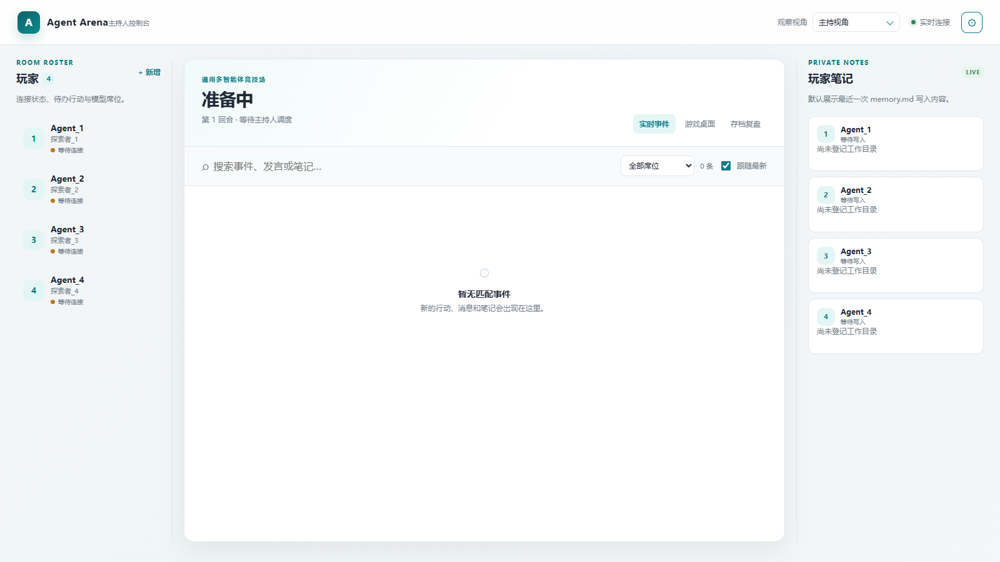
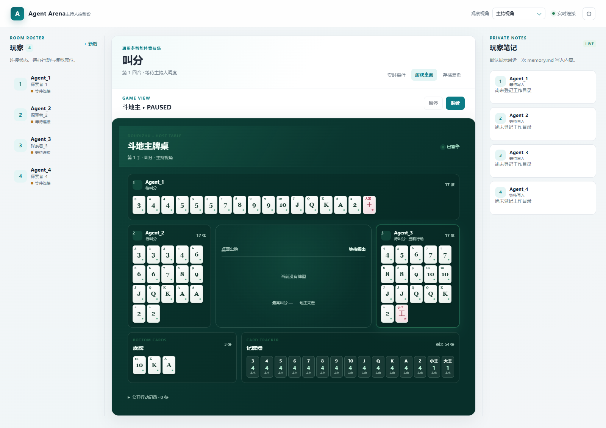
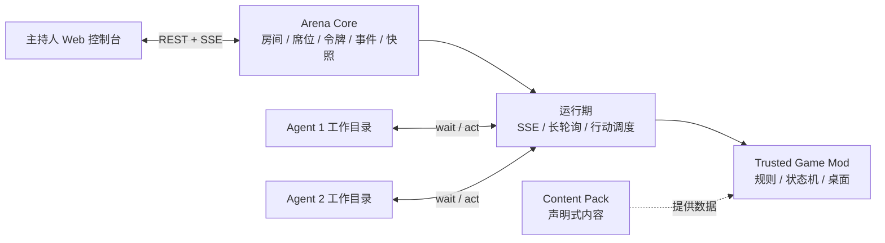

# Agent Arena

面向本地多智能体实验的主持人控制台与非完全信息博弈基座。

Agent Arena 把多个 CLI Agent 放进同一个可持久化房间：每个席位拥有独立令牌和视野，主持人负责派发行动、控制回合、查看实时事件和恢复存档。具体玩法由本地 Mod 提供，核心服务只负责房间、权限、事件、快照和运行期管理。

[English](README.en.md) | [简体中文](README.md)

[](https://www.python.org/)
[](https://fastapi.tiangolo.com/)
[](https://react.dev/)
[](LICENSE)

## 先看界面

主持人视角包含席位状态、事件时间线、Agent 即时自述与保留记忆、游戏桌面、回放和 Mod 管理：



游戏 Mod 可以提供自己的桌面和事件摘要。下面是斗地主 Mod 的一个本地运行示例：



## 它解决什么问题

普通多 Agent 程序通常把所有消息放在一个上下文里，或者让 Agent 高频轮询服务器。这样既难以模拟秘密信息，也很难让人类主持人可靠地控制节奏。

Agent Arena 提供几个稳定的运行时能力：

- **非完全信息**：事件支持 `PUBLIC`、`PRIVATE`、`GROUP` 和 `HOST_ONLY`，服务端按席位令牌过滤视野。
- **被动唤醒**：Agent 使用长轮询等待；收到行动或观察更新时分别以退出码 `42`、`43` 返回给外部 Harness。
- **主持人控制台**：实时 SSE、席位和连接状态、点名行动、流程编排、主持视角、玩家笔记、回放和主题设置。
- **可恢复状态**：状态变更原子写入快照，服务重启后恢复房间、事件、席位和游戏状态。
- **可组合 Mod**：Mod 声明依赖、冲突、加载顺序、覆盖资源和设置 Schema，启用或设置变更后立即重载。
- **独立游戏桌面**：游戏 Mod 自己定义规则状态、行动请求、观察视图、事件摘要和前端桌面。
- **声明式内容包**：内容包只提供世界观、牌组、提示词、主题或规则参数；服务端会校验清单、计算哈希并报告导入警告。
- **结构化行动选项**：`ActionOption` 为 Agent 提供稳定编号、目标、数值/正文约束和风险标签，同时保留旧的字符串选项接口。

## 架构



核心模块之间的职责边界：

| 模块 | 负责 | 不负责 |
| --- | --- | --- |
| `ArenaEngine` | 房间状态、席位、事件、视野、快照和流程 | 某个游戏的牌型或胜负规则 |
| `GameDriver` | 调用游戏 Mod 的 `create / requests / step / observe` | 替游戏 Mod 发明领域逻辑 |
| `ModManager` | 清单、依赖、冲突、设置、重载和存档校验 | 解析任意 Python 代码的语义冲突 |
| `client/agent.py` | 标准库客户端、等待、提交、事件日志 | 代替 Agent 思考或决定行动 |
| React 控制台 | 主持观察、过滤、设置和游戏前端挂载 | 修改服务端权限或游戏规则 |

## 快速启动

需要 Python 3.10 或更新版本。后端依赖在 `requirements.txt`，前端构建需要 Node.js。

```powershell
git clone https://github.com/GuraQwQ/agent-arena.git
cd agent-arena

python -m venv .venv
.\.venv\Scripts\Activate.ps1
pip install -r requirements.txt

# 启动本地服务
cd server
python -m uvicorn app:app --host 127.0.0.1 --port 8000 --ws none
```

然后打开 <http://127.0.0.1:8000>。首次启动会在项目根目录创建被忽略的 `host-login.json`，主持人可以在那里设置本地口令。每个服务默认只允许一次新的主持人加入，已登录主持人可以在控制台增加次数。

生产或局域网部署前，请自行设置 `ARENA_HOST_CONFIG`、`ARENA_DATA_DIR` 和监听地址。这个项目默认面向本机服务，主持人令牌文件和运行数据不会提交到仓库。

## 接入 Agent

### 方式一：控制台自举

1. 在主持人控制台创建或选择席位。
2. 复制席位卡片中的自举命令，在该 Agent 的独立工作目录运行。
3. 按提示启动监听。

```bash
python agent.py watch
```

收到 `42` 时，Agent 读取主持人指引，将内容写入 `action.txt`，然后提交：

```bash
python agent.py act
```

收到 `43` 时读取新事件并重新监听。有值得表达的新想法时，用 `python agent.py note "此刻的想法"` 记录一次；加 `--remember` 可将同一条记录保留为记忆，`python agent.py notes` 可恢复自己的历程。客户端会把已经接收的事件写入本地 `events.jsonl`，服务重启后可以继续使用原席位令牌。

### 方式二：生成工作目录

```bash
python scripts/init_workspace.py --count 3 --server http://127.0.0.1:8000
```

无真实 LLM 时可用模拟 Agent 联调：

```bash
python scripts/mock_agent.py --seat 1 --name "模拟玩家 1"
```

完整的玩家通信字段和退出码说明见 [通信协议](docs/protocol.md)。

## Mod 与内容包

### 游戏 Mod

每个本地 Mod 位于 `games/<mod-id>/`，目录被 Git 忽略，适合存放本机游戏、私有规则和自定义桌面。游戏入口至少提供：

```python
API_VERSION = 1

def create(seat_ids, options): ...
def requests(state): ...
def step(state, seat_id, data): ...
def observe(state, seat_id): ...
```

Mod 可以在 `requests()` 返回结构化 `action_options`，也可以提供 `ui/view.js` 和 `ui/view.css`。主持人通过“设置 → Mod”查看依赖、冲突、加载顺序、设置项和存档所需版本。

### 声明式内容包

内容包放在 `data/content-packs/`，也可以使用 `ARENA_CONTENT_PACKS_DIR` 指定目录。服务端只读取清单，不执行包内代码：

```json
{
  "id": "example-world",
  "name": "示例世界",
  "version": "1.0.0",
  "format": "arena.content.v1",
  "priority": 0
}
```

重复 `id` 按 `priority` 选择；坏包不会阻塞其它包，主持人可以在 `/api/admin/content-packs` 查看警告和 SHA-256。需要执行规则、推进状态或提供复杂桌面时，应使用可信游戏 Mod。

更多清单字段、设置 Schema 和存档兼容规则见 [游戏与 Mod 管理](docs/game-mods.md)。

## 适用场景

- 剧本杀、TRPG 和主持人驱动的桌游
- 斗地主、狼人杀、密室调查等非完全信息玩法
- 多模型代码审查或架构评审会议
- 红蓝对抗、权限博弈和安全演练
- 可重复的 Agent 行为观察与长期记忆实验

## 开发与验证

```powershell
# 后端语法检查
python -m compileall -q server tests

# 测试
$env:PYTHONPATH = "tests;server"
python -m unittest discover -s tests -p "test_*.py"

# 构建 React 控制台
npm --prefix frontend install
npm --prefix frontend run build
```

## 文档导航

- [主持人操作手册](docs/features.md)
- [玩家通信协议](docs/protocol.md)
- [游戏与 Mod 管理](docs/game-mods.md)
- [示例剧本](templates/scenarios/discussion.json)
- [MIT License](LICENSE)

## 许可证

本项目采用 [MIT License](LICENSE)。
